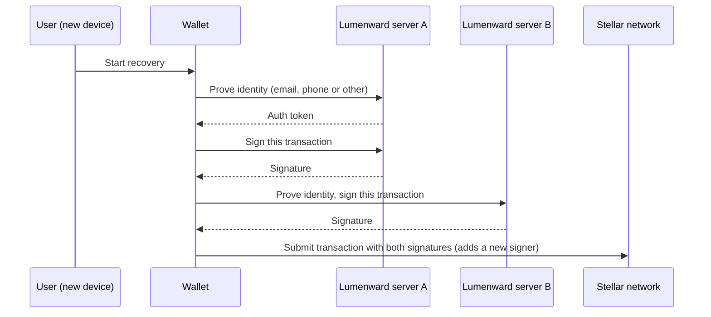

<p align="center">
  
</p>

<p align="center">
  <a href="LICENSE"></a>
  <a href="https://github.com/<your-org>/lumenward/actions/workflows/ci.yml">/lumenward/actions/workflows/ci.yml/badge.svg"></a>
  
  
  
  
</p>

**Lumenward** is an open-source server that lets a Stellar wallet recover an account after the user loses their key. It implements [SEP-30](https://github.com/stellar/stellar-protocol/blob/master/ecosystem/sep-0030.md), the Stellar standard for multi-party account recovery. You run it yourself. Two or more independent Lumenward servers each hold a signing key for the account, and no single server can move funds alone.

It also ships the **Recovery Set Auditor**, a command that checks whether an account's signers are really set up that way.

> **Status: pre-alpha. Unaudited. Do not use it to protect real mainnet funds.**
> The server and auditor work and are tested. Several production features are open issues. See [What works today](#what-works-today).

---

## Why this exists

A Stellar account is controlled by its keys. Lose the key and the account is gone. SEP-30 solves this without handing one third party control:

1. The wallet registers the account with two or more recovery servers.
2. Each server creates its own signing key for that account.
3. The wallet adds those keys as signers, with thresholds set so that no one server can sign alone.
4. If the user loses their key, they prove who they are to each server (email, phone, or another Stellar account), and each server signs one recovery transaction.

The wallet side already exists in the official Stellar wallet SDKs. The server side is thin: the Go reference implementation lives under `exp/` (experimental) in the Stellar Go repo. Lumenward aims to be a maintained, documented, self-hostable server wallet teams can run.

## How recovery works



The SEP gives one example: set the account thresholds to high 2, medium 2, low 2, and give each server's signing key weight 1. Neither server can act alone, but together they can approve a transaction.

A single-server setup is allowed by the SEP, but then that server is effectively a custodian. Lumenward recommends two or more **independent** operators.

## What works today

| Area | Status |
|---|---|
| All six SEP-30 endpoints, with `400`, `401`, `404`, `409` errors | Working, tested |
| SEP-10 token check (key set, or shared secret for development) | Working, tested |
| External identity tokens (`email`, `phone_number` claims) | Working, tested. You bring the identity provider |
| Per-account signing keys, AES-256-GCM encryption at rest | Working, tested |
| Transaction checks before signing (source accounts, fee-bump refused) | Working, tested |
| Signing key rotation (`AccountService.rotateSigningKey`) | Working, tested. No command yet |
| Memory and SQLite storage | Working, tested |
| Recovery Set Auditor (`lumenward-audit`) | Working, tested |
| Docker image and two-server demo compose file | Written, **not yet tested** |
| Rate limiting, Postgres, KMS, audit log, metrics, OTP providers | Planned. See open issues |

**58 tests** cover encryption, signing rules, both stores, the auditor and the full API.

## Quick start

Requires Node 22.13 or newer. No C++ toolchain is needed: storage uses Node's built-in SQLite module, which prints a one-time "experimental" warning at startup.

```bash
git clone https://github.com/<your-org>/lumenward.git
cd lumenward
npm install
cp .env.example .env
```

Edit `.env`:

```bash
npm run keygen          # prints a value for KEY_ENCRYPTION_KEY
# set SEP10_JWT_SECRET to any long random string (development only)
```

Run it:

```bash
set -a; source .env; set +a
npm run dev
```

Try it. Mint a test token for any account address, then register that account:

```bash
ACCOUNT=G...                                   # a Stellar address
TOKEN=$(npm run -s token -- --kind sep10 --sub $ACCOUNT)

curl -X POST localhost:8080/accounts/$ACCOUNT \
  -H "Authorization: Bearer $TOKEN" -H "content-type: application/json" \
  -d '{"identities":[{"role":"owner","auth_methods":[{"type":"stellar_address","value":"'$ACCOUNT'"}]}]}'
```

The response contains the server's new signing key under `signers`. The `token` command is for development only. In production, tokens come from your SEP-10 server and identity provider.

## Configuration

| Variable | Required | Purpose |
|---|---|---|
| `KEY_ENCRYPTION_KEY` | Yes | 32 random bytes, base64. Encrypts signing keys at rest. **Back it up.** |
| `SEP10_JWKS` or `SEP10_JWT_SECRET` | Yes | How SEP-10 tokens are verified. Use `SEP10_JWKS` in production |
| `SEP10_ISSUER` | No | Required token issuer |
| `EXTERNAL_JWKS` or `EXTERNAL_JWT_SECRET`, `EXTERNAL_ISSUER` | No | Same, for email and phone identity tokens |
| `NETWORK_PASSPHRASE` | No | Defaults to testnet. Set the public network passphrase for mainnet |
| `ALLOWED_SOURCE_ACCOUNTS` | No | Extra accounts a transaction may use as a source, for example a sponsor |
| `STORE` | No | `sqlite` (default) or `memory` |
| `DATABASE_PATH` | No | SQLite file. Default `./data/lumenward.db` |
| `HOST`, `PORT`, `LOG_LEVEL` | No | Defaults `0.0.0.0`, `8080`, `info` |

## API

Lumenward follows SEP-30 v0.8.1. Send `Authorization: Bearer <jwt>` on every call.

| Method and path | What it does | Token |
|---|---|---|
| `POST /accounts/<address>` | Register an account with its identities | SEP-10 for that account |
| `PUT /accounts/<address>` | Replace the identities on an account | SEP-10 or external |
| `GET /accounts/<address>` | Read the account and its signers | SEP-10 or external |
| `DELETE /accounts/<address>` | Delete the account record (cannot be undone) | SEP-10 or external |
| `GET /accounts` | List accounts the token can access. Page with `?after=<last address>` | SEP-10 or external |
| `POST /accounts/<address>/sign/<signing-address>` | Sign a base64 XDR transaction for the account | SEP-10 or external |
| `GET /healthz` | Health check (not part of SEP-30, no token) | None |

Errors are JSON like `{ "error": "..." }` with status `400`, `401`, `404` or `409`. A caller with no access to an account gets `404`, the same as for a missing account. Identities never include auth methods in responses, and signers are listed newest first.

Full specification: [SEP-30](https://github.com/stellar/stellar-protocol/blob/master/ecosystem/sep-0030.md), which depends on [SEP-10](https://github.com/stellar/stellar-protocol/blob/master/ecosystem/sep-0010.md).

## Recovery Set Auditor

Checks whether an account's signers are set up so that no single recovery server can act alone.

```bash
npm run audit -- <ACCOUNT> --recovery-key <G...from server A> --recovery-key <G...from server B>
```

```text
OK       recovery-set-ok: No single server can act alone, and 2 servers together reach the high threshold (2 >= 2).
```

A bad setup:

```text
CRITICAL single-server-control: GAN7... has weight 1, which meets the high threshold (1). That one server can change signers or merge the account alone.
```

| Finding | Severity | Meaning |
|---|---|---|
| `single-server-control` | Critical | One recovery key meets the high threshold by itself |
| `shared-key` | Critical | The same key is listed for two servers |
| `recovery-key-missing` | Warning | A key is not an active signer on the account |
| `single-recovery-server` | Warning | Fewer than two servers |
| `recovery-not-sufficient` | Warning | The servers together cannot reach the high threshold |
| `recovery-set-ok` | OK | No problems found |

Options: `--horizon <url>` (default `https://horizon.stellar.org`), `--file account.json` to read a saved account response, `--json` for machine output. Exit code `0` means no critical findings, `1` a critical finding, `2` a usage or network error.

The auditor reads the `signers` and `thresholds` fields of a Horizon account object. If Horizon is unavailable to you, save an account response and use `--file`.

## Security notice

A recovery server holds signing keys for many accounts. Treat it like any other key-holding service.

- **Unaudited.** No independent review has happened. Do not use real funds.
- **The key encryption key is critical.** Whoever has it and the database can sign for every account.
- **One operator means custody.** Safety needs two or more independent operators and thresholds that require them together. Run the auditor.
- **Identities are a weak point.** An email or phone number is only as strong as the identity provider behind it.
- **No rate limiting yet.** Put Lumenward behind a reverse proxy that limits requests.
- **SEP-30 is still a Draft.** It may change.

Found a vulnerability? Do not open a public issue. See [SECURITY.md](SECURITY.md). More detail: [docs/architecture.md](docs/architecture.md).

## Project layout

```text
lumenward/
├── src/
│   ├── api/        # Fastify routes
│   ├── auth/       # token verification and principals
│   ├── service/    # business rules and input validation
│   ├── signing/    # transaction checks before signing
│   ├── crypto/     # signing key creation and encryption
│   ├── store/      # memory and SQLite stores, access rule
│   ├── audit/      # recovery set auditor logic
│   ├── cli/        # lumenward-audit
│   └── dev/        # development token helper
├── test/           # 58 tests
├── scripts/        # issues.json and create-issues.mjs
├── docs/
├── Dockerfile
└── docker-compose.yml   # two-server demo (not for production)
```

## Roadmap and open issues

Planned work is split by area so contributors can pick a scoped task. The full list with requirements is in [`scripts/issues.json`](scripts/issues.json).

| Area | Planned work | Levels |
|---|---|---|
| Security | Rate limiting and lockout, HTTP hardening | Medium |
| Storage | PostgreSQL store | High |
| Keys | Rotation command, KMS envelope encryption | High |
| Authentication | Email and SMS code providers, muxed SEP-10 subjects | Medium |
| Signing | Operation allow list, time bounds policy | Medium |
| Operations | Audit log, metrics, Dependabot and audit job | High, Medium, Trivial |
| Auditor | GitHub Action, read keys from running servers | Medium |
| Testing | SEP-30 conformance suite, two-server recovery test | High |
| Docs | OpenAPI, operator guide, wallet integration guide | Medium |

Each issue follows the Drips Wave format: description, requirements and context, suggested execution, tests, and a complexity label.

## Contributing

We are applying to the Stellar Wave Program on Drips Wave. Whether or not a Wave is running, the rules are the same:

1. Read [CONTRIBUTING.md](CONTRIBUTING.md).
2. Comment on an issue to ask for assignment before you start.
3. Open a pull request that includes `Closes #<issue-number>`.
4. Add tests. `npm test`, `npm run typecheck` and `npm run build` must pass.
5. Only submit work you understand. Low-effort or untested AI-generated pull requests will be closed.

## Maintainers

| Name | Role | GitHub | Telegram |
|---|---|---|---|
| Wale | Lead maintainer | `@<your-github>` | `@<your-telegram>` |

## Community

Questions and ideas: `<your-community-link>`

## Contributors

<a href="https://github.com/<your-org>/lumenward/graphs/contributors">
  /lumenward" alt="Contributors">
</a>

## Resources

- [SEP-30: Account Recovery](https://github.com/stellar/stellar-protocol/blob/master/ecosystem/sep-0030.md)
- [SEP-10: Stellar Web Authentication](https://github.com/stellar/stellar-protocol/blob/master/ecosystem/sep-0010.md)

## License

MIT. See [LICENSE](LICENSE).
