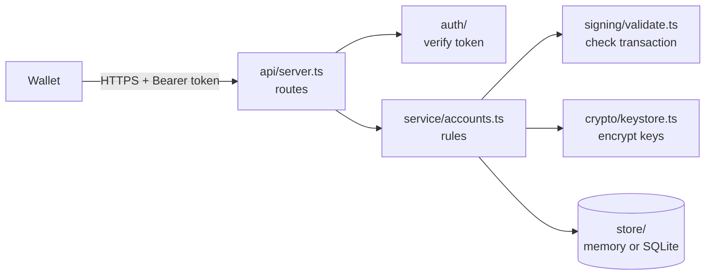

# Architecture

Lumenward is one Node.js process with five small parts. Each part has one job.



| Part | Folder | Job |
|---|---|---|
| Routes | `src/api` | Six SEP-30 endpoints, error format, body size limit |
| Auth | `src/auth` | Verify SEP-10 and external tokens and turn them into a `Principal` |
| Service | `src/service` | All business rules: who may do what |
| Signing | `src/signing` | Decide whether a transaction may be signed |
| Keys | `src/crypto` | Create signing keys and encrypt them at rest |
| Store | `src/store` | Save accounts. Memory and SQLite today |
| Auditor | `src/audit`, `src/cli` | Check an account's recovery signer set |

## Who is the caller?

Every request carries `Authorization: Bearer <jwt>`. The token becomes a `Principal`:

- A **SEP-10 token** proves control of a Stellar account. Its `sub` is `G...` or `G...:memo`. The principal gets `sep10Address` and a `stellar_address` method.
- An **external token** comes from an identity provider the operator trusts. It carries the OpenID Connect claims `email` and/or `phone_number`. A claim is ignored if the issuer marks it unverified.

Verification uses `jose`. With a key set (JWKS) only asymmetric algorithms are accepted. With a shared secret (development only) only HS256 is accepted. Tokens must have `exp` and `sub`.

## Who may access an account?

`src/store/access.ts` holds the one rule:

1. The account's own SEP-10 token always has access.
2. Otherwise the caller needs an auth method that matches one of the account's identities.
3. Emails compare case-insensitively.
4. No access returns `404`, the same as a missing account, so callers cannot probe which accounts exist.

Only a SEP-10 token for the same address may **register** an account.

## Data model

```text
AccountRecord
  address        the registered Stellar account (G...)
  identities[]   { role?, auth_methods[]: { type, value } }
  signingKeys[]  { publicKey, encryptedSecret, createdAt }   oldest first
```

Responses never include auth methods. Identities appear only as `{ role, authenticated? }`. Signers are returned newest first.

## Signing a transaction

1. Check the caller may access the account (else `404`).
2. Find the requested signing key on the account (else `404`).
3. Parse the XDR. Reject fee-bump transactions.
4. The transaction source and every operation source must be the registered account or an `ALLOWED_SOURCE_ACCOUNTS` entry (else `400`). Anything else, including muxed sources, fails closed.
5. Decrypt the signing key, sign the transaction hash, return the base64 signature and the network passphrase.

## Keys at rest

Each signing secret is encrypted with AES-256-GCM using `KEY_ENCRYPTION_KEY`. The public key is bound in as additional authenticated data, so a ciphertext cannot be moved to another record. The stored format starts with `v1.` so the scheme can change later.

## What is not here yet

Rate limiting, a Postgres store, KMS support, an audit log and metrics are open issues. Until they exist, run Lumenward behind a reverse proxy that limits requests.

## Threat notes

- **The key encryption key is the crown jewel.** Anyone with it and the database can sign for every account. Back it up and protect it.
- **One operator is one point of failure.** SEP-30 is only safe when two or more independent operators each hold a key and thresholds require them together. Use `lumenward-audit` to check.
- **Identities are only as strong as the identity provider.** A weak email or phone check weakens recovery.
- **Sponsoring accounts.** If you list an account in `ALLOWED_SOURCE_ACCOUNTS`, never make a Lumenward signing key a signer of it.
